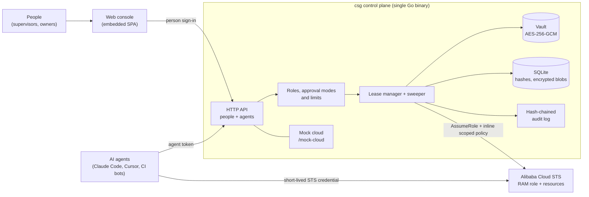

# Cloud Safeguard

**Short-lived access, not long-lived keys.**

Cloud Safeguard is a self-hosted control plane that lets AI agents work in a real cloud
account without ever holding a long-lived AccessKey. An agent belongs to a person and
inherits that person's role on each cloud account. It asks for access to one kind of
resource, at one level (read, write or full), for a short time. It gets back a short-lived
STS credential whose policy allows exactly that. Read access can be automatic; anything
above it waits for the person who owns the agent. Everything expires, can be revoked and is
recorded.

> Status: single-tenant, Alibaba Cloud (`sts` + `mock`), one Go binary with an embedded web
> console. It runs locally end to end against the built-in mock cloud; it has not been run
> against a live Alibaba Cloud account yet. Limitations are listed below.

---

## The problem

If you let an AI coding agent (Claude Code, Cursor, Codex, DSH, a CI bot) run your cloud
account today, the convenient setup is one long-lived AK/SK pair with broad permissions.
That convenience has a price:

1. **The key gets copied everywhere.** In practice it lands in the agent's own config,
   a server's `~/.aliyun/config.json`, `~/.acme.sh/account.conf` for DNS-01 certificate
   renewals, CI secrets and shell history. Rotating it means hunting every copy — and a
   missed copy silently breaks certificate renewal months later.
2. **Broad permissions are the only low-friction option.** `AdministratorAccess` avoids
   endless RAM policy fiddling, but one leaked key — in agent logs, a pasted transcript,
   a compromised host — is full account takeover.
3. **Least privilege costs a RAM-console round trip.** Every new task ("add this TXT
   record", "restart that instance") means editing a policy, waiting, testing, repeating.
   People give up and go back to full admin.
4. **Cloud audit trails don't attribute actions to agents.** ActionTrail shows *a RAM
   user* did something. It cannot tell you which agent, which task, which approved
   intent.
5. **Approving every command is not a middle ground.** It turns the agent into a
   chat-driven shell and removes the reason to use one.

The real tension is **convenience vs least privilege vs accountability**. Cloud Safeguard
is the missing middle: instant access for low-risk work, one-click approval for risky
work, and a tamper-evident record of every request and cloud call.

## How it works

```
Person  → signs in to the console (password + authenticator app)
Agent   → csg login: shows a short code; its owner approves it in the console
Agent   → asks: cloud account + resource (ecs/dns/oss) + permission (read/write/full)
                + validity period [+ one resource name] [+ reason]
        → the owner's role on that account decides whether it is allowed at all
        → the owner's approval mode on that account decides: issue now, or wait
          for the owner
        → the vault decrypts the broker AccessKey (in-process only)
        → AssumeRole with a policy written for exactly this request
        → the agent gets a short-lived STS credential (environment variables)
        → deadline · revocation · hash-chained audit log
```

| Who | What they can do |
| --- | --- |
| Supervisor | Manages cloud accounts, people, roles and limits. Administrator on every cloud account. Can stop any request or credential, and can approve only their own agents' requests. |
| Person | Has a role per cloud account: Guest (read), Member (read, write), Administrator (read, write, full). Approves their own agents' requests. |
| Agent | Belongs to one person and can never get more than that person's role allows. |

Nobody, at any role, can get permission to manage RAM users, roles or policies: every
credential carries an explicit deny for it.

The long-lived broker AccessKey lives only in an AES-256-GCM vault inside the control
plane. Agents hold a platform token, not a cloud key.

### Architecture



The rules for people, roles, requests and approval: [docs/CONTRACT.md](docs/CONTRACT.md) §17.

## What it does

| Feature | Status |
| --- | --- |
| People sign in to the console with a password and an authenticator app; no SSO | ✅ |
| Roles per cloud account (Guest, Member, Administrator); supervisors manage the platform | ✅ |
| Agents sign in with a short code a person approves; no token is copied by hand | ✅ |
| Access requests: cloud account, resource type (ECS, DNS, OSS on Alibaba Cloud; S3 on AWS), read / write / full, validity, optional resource name | ✅ |
| Approval modes per person and cloud account (Read, Write, Full) | ✅ |
| Refresh: a new key under the same request within its refresh window (default 8 hours); SDK credential process output | ✅ |
| Only the agent's owner approves; supervisors can deny or revoke anything, never approve for someone else | ✅ |
| STS credentials with a policy scoped to the request; RAM management always denied | ✅ |
| Deadlines, a background sweeper, and revocation when a role is lowered, a person is suspended or an account is disabled | ✅ |
| AES-256-GCM vault for the broker AccessKey and issued credentials; one-place key replacement | ✅ |
| Tamper-evident, hash-chained audit log naming who caused each event | ✅ |
| `csg` CLI for agents and an MCP server (`csg mcp`) for Claude, Cursor and others | ✅ |
| Mock cloud and a scripted demo (no cloud account needed) | ✅ |
| Real Alibaba Cloud `sts` mode | ✅ implemented, unit-tested against a fake STS endpoint; not yet run against a live account |
| `csg` sign-in for people, with supervisor commands (raising access needs an authenticator code) | ✅ |
| Remote MCP over HTTPS: an agent connects with just a URL, signs in through the console (OAuth), and gets credentials through one-time links | ✅ tried with Claude Code |
| AWS accounts: STS AssumeRole with a session policy per request; S3 buckets | ✅ mock-tested and against a fake STS; not yet run against a live AWS account |
| Long-lived credentials (a cloud user and key that do not expire) for supervisors and people they allow: an agent gets only a console link, the owner creates the key and sees the secret once, it is deleted when they lose the right | ✅ mock-tested and against fake IAM/RAM; not yet run against a live cloud |
| GCP, SSO, chat approvals, credential-free proxy mode | 🔜 later |

The rules are in [docs/CONTRACT.md](docs/CONTRACT.md) §17.

## Quickstart (demo mode, no cloud account needed)

Prerequisites: Go 1.24+, Node.js ≥ 20 with npm, macOS or Linux, an authenticator app.

```bash
# 1. Build the console and the single binary (build/csg)
make build

# 2. Create a throwaway instance with a mock cloud account.
#    It prints one secret, once: the first supervisor's setup code.
./build/csg init --demo --data-dir .demo/data

# 3. Start the control plane (console and API on loopback)
./build/csg serve --data-dir .demo/data
#    Open http://127.0.0.1:8787, choose "Set up your account" and use the setup code.
```

In a second terminal, sign an agent in and ask for access:

```bash
./build/csg login --server http://127.0.0.1:8787 --name my-agent
#    Prints a link and a short code. Approve it in the console; the agent is now yours.

./build/csg accounts
#    The cloud accounts this agent may ask for, and up to which permission.

# Read access is issued at once. csg exec runs one command with the credential and
# gives it back afterwards.
./build/csg exec --account 1234567890123456 --resource ecs --permission read --ttl 10m \
  -- ./build/csg mock request GET /v1/ecs/instances

# Write access waits for you in the console's Inbox.
./build/csg access request --account 1234567890123456 --resource ecs --permission write \
  --name i-2ze0demo001 --ttl 10m --reason "restart after a config change" --wait 5m
```

People can work from the command line too. `csg person login` signs you in by approving a
code in the console; then you can read everything and lower access from the terminal.
Anything that raises access asks for a code from your authenticator app, and approving
requests and sign-ins stays in the console, so an agent that reads the saved session can
never approve itself:

```bash
./build/csg person login --server http://127.0.0.1:8787
./build/csg me requests                     # your agents' requests
./build/csg supervisor people               # supervisors: people, roles, accounts, settings, audit
./build/csg supervisor roles set 1234567890123456 mei member --code 123456
```

Or run the whole scripted demo (fourteen scenarios: setup, agent sign-in, automatic read, least
privilege, denial, approval, revocation, emergency stop, a supervisor on the command line,
remote MCP, approval mode per account with refresh, an AWS account, a long-lived key, audit) in one command:

```bash
make demo
```

The step-by-step path, the MCP setup and the real-cloud setup are in
[docs/QUICKSTART.md](docs/QUICKSTART.md).

## CLI cheatsheet

| Area | Command |
| --- | --- |
| Server host | `csg init [--demo] [--data-dir DIR] [--supervisor NAME]` · `csg serve [--data-dir DIR] [--addr 127.0.0.1:8787] [--public-url URL]` · `csg supervisor recover --username NAME` |
| Agent sign-in | `csg login --server URL [--name NAME]` · `csg whoami` · `csg version` |
| Agent | `csg accounts` · `csg access request --account ID --resource R --permission P --ttl 15m [--max-lifetime 8h] [--name N] [--reason ...] [--wait 5m]` · `csg access status ID` · `csg access refresh ID` · `csg access long-lived --account ID --resource R --permission P --reason ...` (prints a console link) · `csg credential --lease ID --export\|--process aws\|aliyun` |
| Agent | `csg exec --account ID --resource R --permission P --ttl 15m -- CMD` · `csg credential --lease ID [--export\|--json]` · `csg revoke --lease ID` · `csg leases mine` |
| MCP | `https://SERVER/mcp` (remote, OAuth sign-in in the console) or `csg mcp` (stdio); tools `list_accounts`, `request_access`, `check_status`, `get_credential`, `refresh_credential`, `request_long_lived_credential`, `revoke` |
| Person sign-in | `csg person login --server URL [--name NAME]` · `csg person whoami` · `csg person logout` |
| Person | `csg me requests [--status S]` · `csg me deny ID` · `csg me revoke ID` · `csg me agents` · `csg me revoke-agent ID` · `csg me accounts` · `csg me mode ACCOUNT read\|write\|full [--for DUR]` · `csg me sessions` · `csg me end-session ID` · `csg me long-lived [revoke ID]` |
| Supervisor | `csg supervisor people [add\|suspend\|activate\|reset\|make-supervisor\|remove-supervisor] …` · `csg supervisor roles [set\|remove] …` · `csg supervisor accounts [show\|test\|enable\|disable\|rename\|set-region\|set-role-arn\|rotate] …` · `csg supervisor settings [set …]` · `csg supervisor audit [verify]` · `csg supervisor requests [deny\|revoke] …` · `csg supervisor long-lived [revoke ID]` · `csg supervisor people allow-long-lived\|disallow-long-lived NAME` |
| Demo | `csg mock request METHOD /v1/PATH [JSON_BODY]` |

Changes that raise access take `--code` (a code from your authenticator app), or ask for it
in a terminal. Adding a cloud account and approving are console-only. The agent's
configuration is resolved as flags > `CSG_SERVER` / `CSG_TOKEN` >
`~/.config/cloud-safeguard/config.json` (0600); a person's session is in
`~/.config/cloud-safeguard/person.json` (0600) and only person commands read it. Exit codes: `0` ok, `1` operation
failed (denied/failed/HTTP error), `2` usage/validation, `3` auth, `4` wait timeout.
Durations accept `90s`, `10m`, `1h` or a plain number of seconds.

## Security highlights

- **No long-lived cloud credential outside the vault.** The broker AK/SK is encrypted at
  rest, never returned by any API, never logged, and decrypted only in-process to mint a
  lease credential.
- **Agents hold a platform token, not a cloud key.** The token is a 32-byte random value
  issued when a person approves the sign-in, saved with mode 0600 and stored on the server
  only as a SHA-256 hash. There is no admin token: people sign in with a password and an
  authenticator app.
- **Least privilege is in the credential, not just the UI.** Every STS credential carries a
  policy written for the request (for example only `ecs:RebootInstance` on one instance),
  an explicit deny for RAM management, and a validity no longer than the platform limit.
- **An agent can never exceed its owner.** The owner's role is read again when a request is
  approved, when its credential is issued and each time it is fetched.
- **Server-side enforcement.** Expiry, concurrency, rate limits, approval revalidation,
  cross-agent isolation and revocation are enforced by the control plane — an agent
  cannot extend, approve or read another agent's lease.
- **Accountability.** The audit log is append-only and hash-chained; every request,
  decision, issuance, fetch, revoke and mock cloud API call names the person or agent that
  caused it. The console's Activity page verifies the chain.
- **One-place rotation.** Replace the broker AccessKey once in the console; no
  agent, server script or cron job changes.
- **Loopback by default.** The server binds `127.0.0.1`; put TLS in front before exposing
  it. See the hardening checklist in [docs/SECURITY.md](docs/SECURITY.md).

Residual risks are documented honestly, not hand-waved: for example, a leaked STS
credential is usable until its short expiry (a real cloud cannot revoke one session
instantly), mock mode is a demo/test path and **not** a security boundary, and the master
key protects secrets at rest only. Read [docs/SECURITY.md](docs/SECURITY.md) before
deploying.

## Project layout

```
cloud-safeguard/
├── cmd/csg/            # main package → single binary
├── internal/
│   ├── model/          # frozen shared domain types (wire contract)
│   ├── store/          # SQLite persistence + hash-chained audit log
│   ├── vault/          # AES-256-GCM envelope encryption
│   ├── policy/         # names of the rules recorded in a request's decision
│   ├── server/         # REST API, sign-in, requests, sweeper, init
│   ├── authn/          # passwords (Argon2id) and authenticator codes (TOTP)
│   ├── provider/       # credential minters: Alibaba Cloud STS + mock
│   ├── capcatalog/     # access templates (resource × permission) and the IAM guard
│   ├── mockcloud/      # built-in demo cloud enforcing scoped policies
│   ├── token/          # bearer token generation and hashing
│   └── cli/            # csg commands and the MCP server
├── web/                # React + Vite console, embedded into the binary
├── scripts/demo.sh     # end-to-end demo (S1–S14), driven by scripts/demo/
├── docs/               # SPEC, CONTRACT, PRODUCT, SECURITY, ARCHITECTURE, QUICKSTART, API, DECISIONS
└── Makefile            # build / test / demo entry points
```

`make build` builds the web console and then the Go binary; `make test` runs
`go test ./...`; `make demo` runs the mock-cloud end-to-end demo on `127.0.0.1:18787`.

## Limitations & roadmap

Current boundaries:

- **Single-tenant.** People sign in with a password and an authenticator app; there is no
  SSO yet.
- **Alibaba Cloud only**, with ECS, DNS and OSS as the resource types.
- **Remote MCP answers JSON only.** `/mcp` serves POST without server-sent events, and
  has no CORS, so browser-based MCP clients cannot call it directly. There are no refresh
  tokens: the agent's token lasts until the agent is revoked on the Agents page.
- **STS credentials still reach the agent.** The stronger design is a credential-free
  proxy where `csg` injects the cloud credential and agents never see one — that is a
  later direction. This bounds blast radius (TTL + inline policy + session name +
  audit) but is not equivalent to proxying.
- **Real STS single-session revocation is not instant.** Revoking a lease stops renewal
  and scrubs the platform's copy; an already-issued real-cloud STS credential remains
  valid until its expiry. Incident response for a suspected leaked credential also
  requires rotating the RAM role policy — see [docs/SECURITY.md](docs/SECURITY.md).
- **Mock mode is for demos and tests, not a security boundary.** Disable it in
  production.
- **No HA / Kubernetes / external database / external KMS or HSM.** Single process,
  SQLite, master key on local disk (or injected via env).
- **The audit hash chain is tamper-evident, not tamper-proof.** It detects partial or
  accidental modification; someone who can rewrite the entire database can recompute the
  whole chain. Off-box log shipping is on the roadmap.
- **No independent security audit, and no live-cloud run yet.** `sts` mode is implemented
  and unit-tested against a fake STS endpoint only.

Roadmap: next, live Alibaba Cloud and AWS tests, more AWS resource types; then GCP, SSO,
chat approvals and a credential-free proxy mode.

## Documentation

| Document | What it covers |
| --- | --- |
| [docs/SPEC.md](docs/SPEC.md) | The original v0.1 product definition (out of date) |
| [docs/CONTRACT.md](docs/CONTRACT.md) | The rules: §17 is the running behaviour (people, roles, requests, approval, API) |
| [docs/PRODUCT.md](docs/PRODUCT.md) | 中文产品说明（v0.1，待重写） |
| [docs/SECURITY.md](docs/SECURITY.md) | Threat model and incident response, written for v0.1 (being rewritten) |
| [docs/ARCHITECTURE.md](docs/ARCHITECTURE.md) | v0.1 architecture (out of date; the vault, audit chain and mock cloud parts still apply) |
| [docs/QUICKSTART.md](docs/QUICKSTART.md) | Demo walkthrough, MCP setup, real Alibaba Cloud setup, troubleshooting |
| [docs/API.md](docs/API.md) | v0.1 endpoint reference (out of date; see CONTRACT §17.8) |
| [docs/DECISIONS.md](docs/DECISIONS.md) | Architecture decision records for v0.1 |
