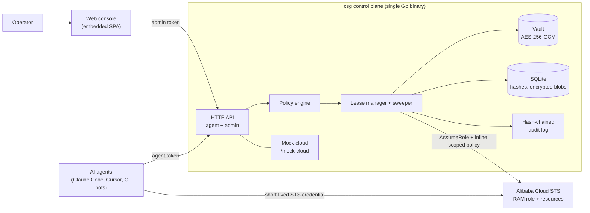

# Cloud Safeguard

**Capabilities, not credentials.**

Cloud Safeguard is a self-hosted control plane that lets AI agents operate a real cloud
account without ever holding a long-lived AccessKey. Agents ask for a **capability** —
a named, least-privilege permission bundle, for a specific resource, for a short time,
with a stated reason. They get a short-lived, policy-scoped STS credential back. Risky
requests wait for one human approval. Everything is expired, revocable and auditable.

> Status: `v0.1.0` MVP — single-tenant, Alibaba Cloud (`sts` + `mock`), one Go binary
> with an embedded web console. This is a working local artifact, not a production
> service yet; limitations are listed below and in [docs/SECURITY.md](docs/SECURITY.md).

---

## The problem

If you let an AI coding agent (Claude Code, Cursor, Codex, DSH, a CI bot) run your cloud
account today, the convenient setup is one long-lived AK/SK pair with broad permissions.
That convenience has a price:

1. **The key gets copied everywhere.** In practice it lands in the agent's own config,
   a server's `~/.aliyun/config.json`, `~/.acme.sh/account.conf` for DNS-01 certificate
   renewals, CI secrets and shell history. Rotating it means hunting every copy — and a
   missed copy silently breaks certificate renewal months later.
2. **Broad permissions are the only low-friction option.** `AdministratorAccess` avoids
   endless RAM policy fiddling, but one leaked key — in agent logs, a pasted transcript,
   a compromised host — is full account takeover.
3. **Least privilege costs a RAM-console round trip.** Every new task ("add this TXT
   record", "restart that instance") means editing a policy, waiting, testing, repeating.
   People give up and go back to full admin.
4. **Cloud audit trails don't attribute actions to agents.** ActionTrail shows *a RAM
   user* did something. It cannot tell you which agent, which task, which approved
   intent.
5. **Approving every command is not a middle ground.** It turns the agent into a
   chat-driven shell and removes the reason to use one.

The real tension is **convenience vs least privilege vs accountability**. Cloud Safeguard
is the missing middle: instant access for low-risk work, one-click approval for risky
work, and a tamper-evident record of every request and cloud call.

## How it works

```
Agent → requests capability (name + params + TTL + reason)
      → policy engine: auto-approve / require human approval / deny  (explainable reasons)
      → vault decrypts the broker AccessKey (in-process only)
      → AssumeRole with an inline policy rendered for exactly this lease
      → agent receives a short-lived STS credential (env vars, ready for existing CLIs/SDKs)
      → TTL expiry · sweeper · revocation · audit hash chain
```

The long-lived broker AccessKey lives only in an AES-256-GCM vault inside the control
plane. Agents hold **platform tokens**, not cloud keys. Every lease is attributable to an
agent, a capability, a TTL and a decision trail.

### Architecture



Full design: [docs/ARCHITECTURE.md](docs/ARCHITECTURE.md). Normative API/policy/audit
details: [docs/CONTRACT.md](docs/CONTRACT.md). Product definition and acceptance:
[docs/SPEC.md](docs/SPEC.md).

## Feature matrix

| Capability | Status |
| --- | --- |
| Capability catalog (5 built-in least-privilege capabilities + custom definitions) | ✅ v0.1 |
| Agents registered as non-human identities; token shown once, hashed at rest | ✅ v0.1 |
| Risk-based policy engine with explainable allow / require-approval / deny reasons | ✅ v0.1 |
| Auto-approve low-risk, short-TTL requests (zero human interaction) | ✅ v0.1 |
| Human approval queue from both CLI and web console, with note + TTL override | ✅ v0.1 |
| JIT STS credentials minted with an inline policy scoped to the lease | ✅ v0.1 |
| Credential TTLs, background expiry sweeper, credential scrubbing | ✅ v0.1 |
| Revocation by agent or operator; immediate in mock mode | ✅ v0.1 |
| Break-glass capability with forced human approval + critical audit severity | ✅ v0.1 |
| Per-agent TTL, concurrency and rate limits; token rotation; suspend/activate | ✅ v0.1 |
| AES-256-GCM vault for broker credentials and lease credentials | ✅ v0.1 |
| One-place provider credential rotation (console or CLI) | ✅ v0.1 |
| Tamper-evident SHA-256 hash-chained audit log with verify endpoint/command | ✅ v0.1 |
| Embedded React web console (login, overview, approvals, agents, capabilities, leases, providers/vault, audit, settings) | ✅ v0.1 |
| `csg` CLI for agents and operators | ✅ v0.1 |
| Mock cloud + demo mode (full loop with no cloud account) | ✅ v0.1 |
| Real Alibaba Cloud `sts` mode (in-tree RPC v1 signer, no SDK) | ✅ v0.1, unit-tested against a fake STS endpoint — not against a live account in this build |
| Per-parameter grant constraints (e.g. pin a grant to one domain) | 🔜 roadmap P1 |
| Credential-free proxy mode (agent never sees even an STS token) | 🔜 roadmap P1 |
| Chat approvals (Slack/Feishu), SSO/RBAC for humans, multi-tenant | 🔜 roadmap P2 |
| Multi-cloud providers (AWS/GCP/Tencent), SIEM export, external KMS/HSM, HA/RDS | 🔜 roadmap |

`✅ v0.1` = specified in [docs/CONTRACT.md](docs/CONTRACT.md) and part of the accepted
MVP scope. `🔜` = explicitly out of scope for v0.1; see [Roadmap](#limitations--roadmap).

## 5-minute quickstart (demo mode, no cloud account needed)

Prerequisites: Go 1.24+, Node.js ≥ 20 with npm, macOS or Linux.

```bash
# 1. Build the console and the single binary (bin/csg)
make build

# 2. Bootstrap a throwaway demo instance: mock cloud, admin token, two demo agents
./bin/csg init --demo --data-dir .demo/data
#    Copies the printed admin token and agent tokens somewhere safe NOW.
#    They are shown exactly once.

# 3. Start the control plane (console + API on loopback)
./bin/csg serve --data-dir .demo/data
#    Open http://127.0.0.1:8787 and log in with the admin token.
```

In a second terminal, act as the `claude-code` agent (use the `csg_agt_...` token that
`init` printed for `claude-code`):

```bash
export CSG_SERVER=http://127.0.0.1:8787
export CSG_TOKEN='csg_agt_...'

# Low-risk read: auto-approved in milliseconds, no human involved.
./bin/csg request --capability aliyun.cloud.read \
  --reason "collect inventory for weekly report" --wait 30s
#    → status active, decision auto_approve, prints the lease id (lea_...)

# Fetch the short-lived credential as environment variables, then use the demo cloud.
eval "$(./bin/csg credential --lease lea_... --export)"
./bin/csg mock request GET /v1/ecs/instances                 # 200 OK
./bin/csg mock request POST /v1/ecs/instances/i-2ze0demo001/restart
#    → 403 Forbidden.RAM: the read policy cannot restart instances

# Or do request → wait → inject → run → auto-revoke in one command:
./bin/csg exec --capability aliyun.cloud.read --reason "one-shot inventory" \
  -- ./bin/csg mock request GET /v1/ecs/instances
```

Risky work waits for one approval. In a third terminal (admin token from `init`):

```bash
export CSG_SERVER=http://127.0.0.1:8787
export CSG_TOKEN='csg_adm_...'

# The agent asks for DNS rights on one domain; it is parked for approval.
# (Run this in the agent terminal:)
#   ./bin/csg request --capability aliyun.dns.manage --param domain=arveykao.com \
#     --ttl 10m --reason "add ACME DNS-01 TXT record" --wait 2m

./bin/csg leases list --status pending
./bin/csg leases approve lea_... --note "ACME renewal for arveykao.com"
#    The waiting agent continues, fetches its credential and can now add that record —
#    and nothing else.
```

Audit and revoke:

```bash
./bin/csg audit list --limit 20        # every request, decision, issuance and cloud call
./bin/csg audit verify                 # ok=true, event count
./bin/csg leases revoke lea_... --reason "done with demo"
```

Or run the whole scripted demo (S1–S8: auto-approve, least privilege, approval, denial,
break-glass revocation, audit verify) in one command:

```bash
make demo
```

The complete step-by-step path, console walkthrough and real-cloud setup are in
[docs/QUICKSTART.md](docs/QUICKSTART.md).

## CLI cheatsheet

| Area | Command |
| --- | --- |
| Bootstrap | `csg init [--demo] [--data-dir DIR] [--force]` · `csg serve [--data-dir DIR] [--addr 127.0.0.1:8787]` |
| Session | `csg login --server URL --token TOKEN` · `csg whoami` · `csg version` |
| Agent | `csg request --capability ID [--param k=v] [--ttl 10m] [--reason ...] [--break-glass] [--wait 2m]` |
| Agent | `csg credential --lease ID [--export\|--json]` · `csg exec --capability ID -- CMD` · `csg leases mine` · `csg revoke --lease ID` |
| Admin | `csg providers list\|get\|add\|update\|rotate\|test` |
| Admin | `csg caps list\|show` · `csg agents list\|get\|create\|suspend\|activate\|rotate-token` |
| Admin | `csg leases list\|get\|approve\|deny\|revoke` · `csg policy show\|set` |
| Audit | `csg audit list [--action A] [--severity S]` · `csg audit verify` |
| Demo | `csg mock request METHOD /v1/PATH [JSON_BODY]` |

Global config resolution: flags > `CSG_SERVER` / `CSG_TOKEN` env vars >
`~/.config/cloud-safeguard/config.json` (0600). Exit codes: `0` ok, `1` operation
failed (denied/failed/HTTP error), `2` usage/validation, `3` auth, `4` wait timeout.
Durations accept `90s`, `10m`, `1h` or a plain number of seconds.

## Security highlights

- **No long-lived cloud credential outside the vault.** The broker AK/SK is encrypted at
  rest, never returned by any API, never logged, and decrypted only in-process to mint a
  lease credential.
- **Agents hold platform tokens, not cloud keys.** Agent and admin tokens are 32-byte
  CSPRNG values, prefixed (`csg_agt_` / `csg_adm_`), shown once and stored as SHA-256
  hashes. Wrong-kind tokens are rejected.
- **Least privilege is in the credential, not just the UI.** Every minted STS credential
  carries an inline policy rendered from the capability template and the request params
  (e.g. `acs:alidns:*:*:domain/arveykao.com`), with the TTL bounded by capability, agent
  and global ceilings.
- **Server-side enforcement.** Expiry, concurrency, rate limits, approval revalidation,
  cross-agent isolation and revocation are enforced by the control plane — an agent
  cannot extend, approve or read another agent's lease.
- **Accountability.** The audit log is append-only and hash-chained; every request,
  decision, issuance, fetch, revoke and mock cloud API call is attributed to an agent or
  admin actor. `csg audit verify` detects tampering.
- **One-place rotation.** Rotate the broker credential once in the console or CLI; no
  agent, server script or cron job changes.
- **Loopback by default.** The server binds `127.0.0.1`; put TLS in front before exposing
  it. See the hardening checklist in [docs/SECURITY.md](docs/SECURITY.md).

Residual risks are documented honestly, not hand-waved: for example, a leaked STS
credential is usable until its short expiry (a real cloud cannot revoke one session
instantly), mock mode is a demo/test path and **not** a security boundary, and the master
key protects secrets at rest only. Read [docs/SECURITY.md](docs/SECURITY.md) before
deploying.

## Project layout

```
cloud-safeguard/
├── cmd/csg/            # main package → single binary
├── internal/
│   ├── model/          # frozen shared domain types (wire contract)
│   ├── store/          # SQLite persistence + hash-chained audit log
│   ├── vault/          # AES-256-GCM envelope encryption
│   ├── policy/         # explainable risk-based policy engine
│   ├── server/         # REST API, auth, sweeper, init/bootstrap
│   ├── provider/       # credential minters: Alibaba Cloud STS + mock
│   ├── capcatalog/     # built-in least-privilege capabilities
│   ├── mockcloud/      # built-in demo cloud enforcing scoped policies
│   ├── token/          # bearer token generation and hashing
│   └── cli/            # csg command implementations
├── web/                # React + Vite console, embedded into the binary
├── scripts/demo.sh     # end-to-end demo (S1–S8)
├── docs/               # SPEC, CONTRACT, PRODUCT, SECURITY, ARCHITECTURE, QUICKSTART, API, DECISIONS
└── Makefile            # build / test / demo entry points
```

`make build` builds the web console and then the Go binary; `make test` runs
`go test ./...`; `make demo` runs the mock-cloud end-to-end demo on `127.0.0.1:18787`.

## Limitations & roadmap

Honest v0.1 boundaries:

- **Single-tenant, single admin token.** No user accounts, roles, MFA or SSO for humans.
- **Alibaba Cloud only**, and effectively one `aliyun` provider per instance is selected
  (the first created); avoid mixing `mock` and `sts` providers in one installation.
- **STS credentials still reach the agent.** The stronger design is a credential-free
  proxy where `csg` injects the cloud credential and agents never see one — that is the
  P1 direction, not v0.1. This bounds blast radius (TTL + inline policy + session name +
  audit) but is not equivalent to proxying.
- **Real STS single-session revocation is not instant.** Revoking a lease stops renewal
  and scrubs the platform's copy; an already-issued real-cloud STS credential remains
  valid until its expiry. Incident response for a suspected leaked credential also
  requires rotating the RAM role policy — see [docs/SECURITY.md](docs/SECURITY.md).
- **Mock mode is for demos and tests, not a security boundary.** Disable it in
  production.
- **No per-parameter grant constraints yet.** An agent granted `aliyun.dns.manage` may
  pass any valid domain parameter; pinning grants to specific resources is P1.
- **No HA / Kubernetes / external database / external KMS or HSM.** Single process,
  SQLite, master key on local disk (or injected via env).
- **The audit hash chain is tamper-evident, not tamper-proof.** It detects partial or
  accidental modification; someone who can rewrite the entire database can recompute the
  whole chain. Off-box log shipping is on the roadmap.
- **No independent security audit.** `sts` mode is implemented and unit-tested against a
  fake STS endpoint; it has not been exercised against a live cloud account in this build.

Roadmap: **P1** — credential-free proxy mode, per-parameter grant constraints.
**P2** — chat approvals (Slack/Feishu), SSO/RBAC and multi-tenant, more cloud providers,
external KMS/Vault integration, SIEM/audit export, HA deployment.

## Documentation

| Document | What it covers |
| --- | --- |
| [docs/SPEC.md](docs/SPEC.md) | Product definition, scope, demo scenarios, acceptance criteria A1–A16 |
| [docs/CONTRACT.md](docs/CONTRACT.md) | Normative API, CLI, policy, capability, audit and security contract |
| [docs/PRODUCT.md](docs/PRODUCT.md) | 中文产品说明：真实痛点、方案对比、价值主张、边界与路线图 |
| [docs/SECURITY.md](docs/SECURITY.md) | Threat model, guarantees, residual risks, rotation runbook, hardening, incident response |
| [docs/ARCHITECTURE.md](docs/ARCHITECTURE.md) | Components, data model, policy engine, audit chain, sequence diagrams, failure modes |
| [docs/QUICKSTART.md](docs/QUICKSTART.md) | Copy-paste demo path, real Alibaba Cloud `sts` setup, troubleshooting |
| [docs/API.md](docs/API.md) | Endpoint reference with curl examples and error codes |
| [docs/DECISIONS.md](docs/DECISIONS.md) | Architecture decision records for v0.1 |
