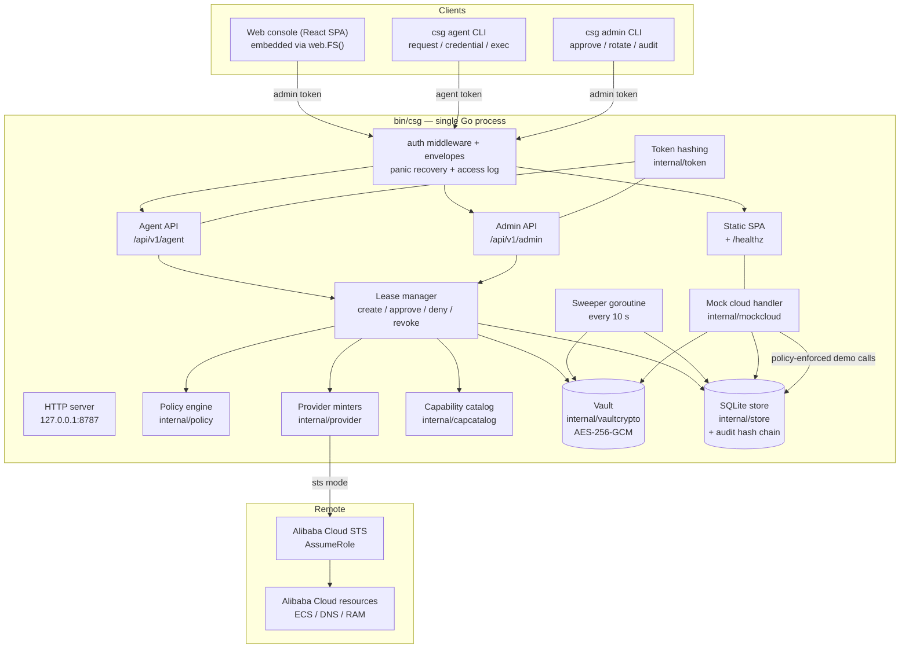
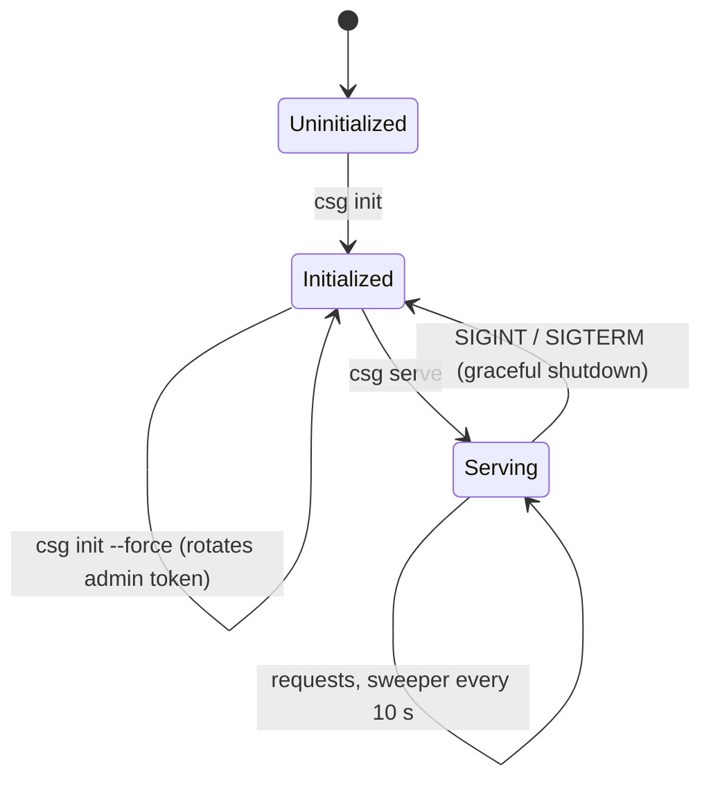
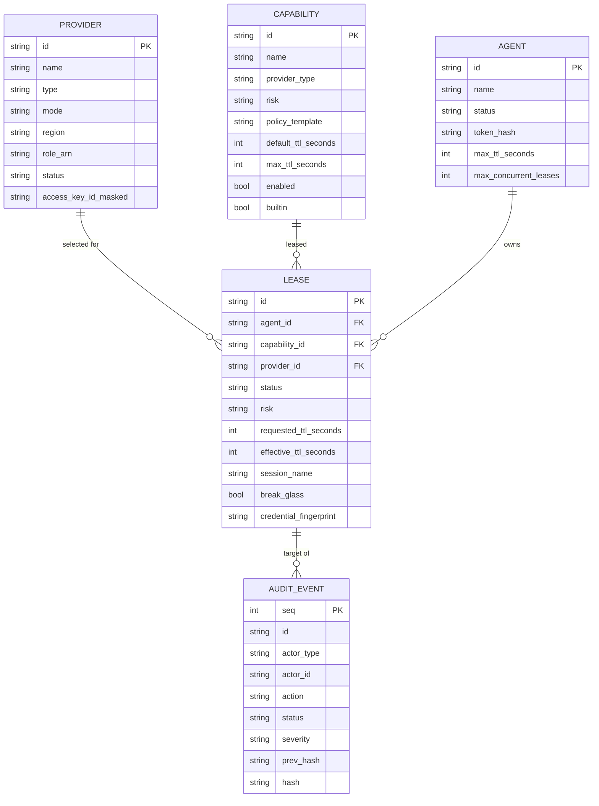
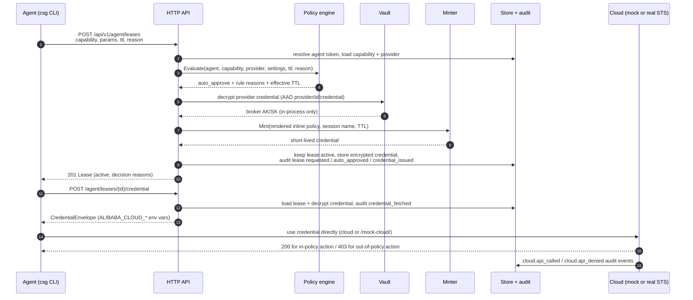
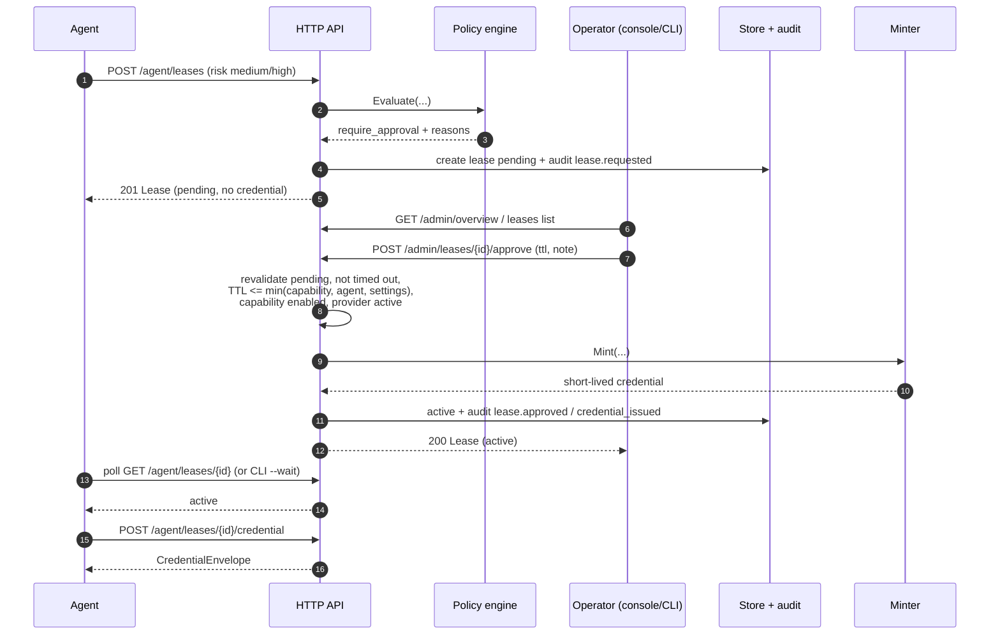
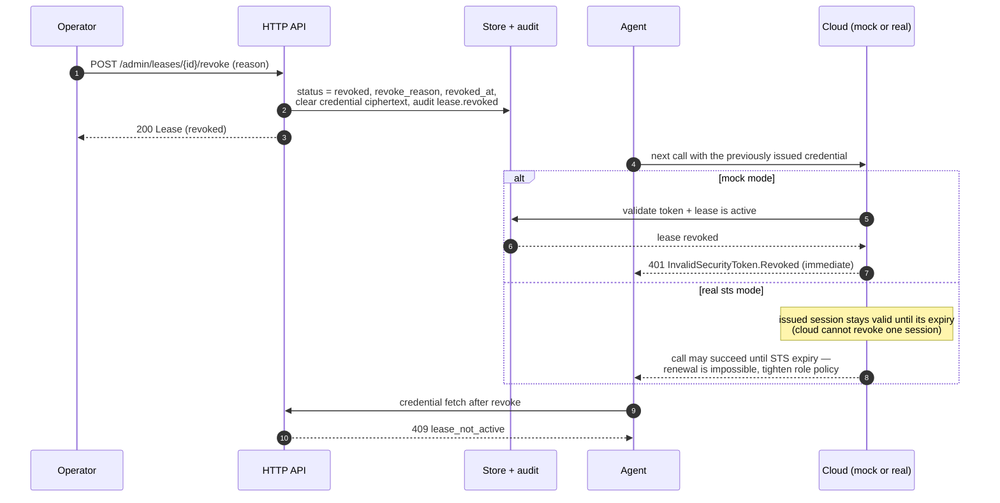
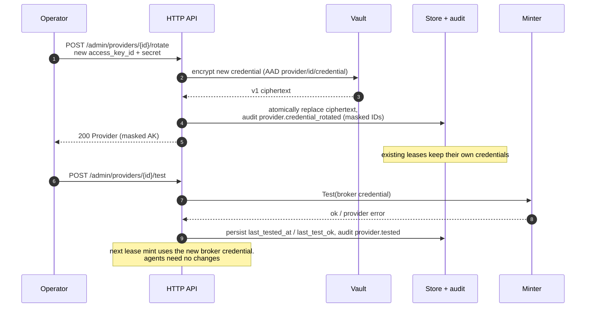

# Cloud Safeguard — Architecture (v0.1)

Status: describes the v0.1 implementation architecture. Normative behavior is frozen in
[CONTRACT.md](CONTRACT.md) (§3–§13); product scope and acceptance in [SPEC.md](SPEC.md).
Shared Go types are `internal/model/model.go`, whose JSON tags are the wire contract.

---

## 1. Design principles

1. **One binary, one process, one data directory.** `csg` embeds the console, the API, the
   sweeper and the mock cloud. No external database, message broker, KMS or cloud SDK.
2. **The control plane is the only authority.** All policy decisions, TTL bounds,
   approvals, revocation and credential issuance happen server-side; the CLI and console
   are clients.
3. **Secrets stay in one process boundary.** Long-lived broker credentials and active
   lease credentials are decrypted only inside the control-plane process, only to mint or
   serve one credential, and never persisted or logged in plaintext.
4. **The lease is the unit of authorization.** Every cloud credential is derived from
   exactly one lease: capability + validated params + TTL + decision + approver.
5. **Everything is explainable and auditable.** Policy decisions carry rule-level reasons;
   every security-relevant action appends to a hash-chained audit log.
6. **Contract-first.** Exported signatures in `internal/model`, `internal/store`,
   `internal/vaultcrypto`, `internal/provider`, `internal/capcatalog`, `internal/mockcloud` and
   `internal/server` are frozen; implementations replace stubs without changing callers.

---

## 2. Components



| Component | Package | Responsibility |
| --- | --- | --- |
| Domain model | `internal/model` | Frozen types + JSON wire contract: Provider, Capability, Agent, Lease, Credential, AuditEvent, PolicySettings, Overview, envelopes, error codes, defaults |
| Persistence | `internal/store` | SQLite schema, CRUD, pagination, sqlite `Store` interface, append-only audit with hash chain, sweeper queries, `Open`/`Close` |
| Crypto | `internal/vaultcrypto` | Master-key load/create, AES-256-GCM `Encrypt`/`Decrypt` with AAD, `KeyFingerprint`, `DeriveKey` |
| Policy | `internal/policy` | Explainable risk-based policy evaluation (CONTRACT §6) |
| Control plane | `internal/server` | Routing, bearer auth, envelopes, lease lifecycle, admin CRUD, overview, init/bootstrap, sweeper, static + mock-cloud mounting, graceful shutdown |
| Credential minters | `internal/provider` | `Minter` interface; `aliyun` STS RPC v1 signer; `mock` HMAC token minter |
| Capability catalog | `internal/capcatalog` | 5 built-in capabilities, `Lookup`, `ValidateParams`, `RenderPolicy` |
| Demo cloud | `internal/mockcloud` | `/mock-cloud/` HTTP handler: token validation, live lease check, IAM policy matching, fixtures, cloud audit events |
| Tokens | `internal/token` | 32-byte token generation, SHA-256 hashing, constant-time compare, prefix/kind helpers |
| CLI | `internal/cli`, `cmd/csg` | All `csg` commands, config resolution, human/`--json` output, exit codes |
| Web console | `web/` (Vite + React + TS) | SPA in `web/dist`, embedded by `web/embed.go` (`web.FS()`), same-origin `/api/v1` |
| Demo | `scripts/demo.sh` | S1–S8 end-to-end script against a throwaway data dir |

Build entry points (`Makefile`): `make build` = web build + `go build -o bin/csg ./cmd/csg`;
`make test` = `go test ./...`; `make demo` = `scripts/demo.sh --port 18787 --data-dir
.demo/data`.

---

## 3. Process lifecycle



`csg init` (CONTRACT §11):

1. Create `<dataDir>` mode 0700; load/create `master.key` (32 random bytes, 0600) or use
   `CSG_MASTER_KEY`; open SQLite (`<dataDir>/csg.db`, 0600 best-effort) and run migrations.
2. Write meta: `instance_id` (`csg_` + random), `admin_token_hash`, `admin_token_prefix`,
   `bootstrap_time`, `demo_mode`, `schema_version=1`.
3. Seed the 5 built-in capabilities (missing rows only, never overwrite).
4. Generate the admin token once; return it in `InitResult`/stdout (optionally write it to
   `--admin-token-file` 0600).
5. With `--demo`: seed provider `demo-aliyun` (`aliyun`/`mock`, region `cn-hangzhou`, role
   ARN `acs:ram::1234567890123456:role/csg-demo`, placeholder AccessKey) and agents
   `claude-code` (all five capabilities, max TTL 3600, concurrency 3) and
   `hermes-researcher` (`aliyun.cloud.read` only, max TTL 900, concurrency 1); return their
   one-time tokens in `InitResult.Agents`.
6. Set default policy settings; print data dir, admin token (once), token prefix and the
   "store these tokens now" warning. Refuse an initialized dir without `--force`.

`csg serve` requires an initialized data dir (clear error otherwise). On startup it opens
the store/vault, builds the mux, logs the console URL + API URL, starts the sweeper and the
HTTP listener, and serves until `SIGINT`/`SIGTERM`, then shuts down gracefully with a
timeout-bounded `http.Server.Shutdown`. It seeds nothing at serve time.

---

## 4. HTTP layer

| Area | Detail |
| --- | --- |
| Listen | `127.0.0.1:8787` default, loopback only; `--addr` to override (put TLS in front) |
| Prefixes | API `/api/v1/`, mock cloud `/mock-cloud/`, health `/healthz`, console `/` |
| Auth | `Authorization: Bearer <token>` on every `/api/v1/*`; agent routes require `csg_agt_`, admin routes `csg_adm_`; wrong kind → 401; suspended/revoked agent → 403 |
| Envelopes | Success `{"data":...}`; error `{"error":{"code","message","details"}}`; lists `{"data":{"items":[...],"total":N}}`; `/healthz` returns `model.Health` directly |
| Limits | 10 s HTTP timeouts; 1 MiB max request body; JSON panic recovery; no-cache SPA shell (`index.html`) |
| Access log | One line per request: `method path status duration_ms` — no bodies, no `Authorization` values |
| Static | `GET /` → embedded `index.html`; unknown non-API GET → SPA fallback (`index.html`) |
| Mock cloud | Mounted only when at least one `mock` provider exists |

Auth resolution for agent tokens is `SHA-256(token)` → `agents.token_hash`; admin tokens are
compared constant-time against the single `admin_token_hash` in meta. Authenticated agent
requests refresh `last_seen_at` at most once per 60 s.

---

## 5. Data model

The logical model is frozen in `internal/model/model.go`; the physical SQLite schema is an
implementation detail of `internal/store` (migrations, `schema_version=1`). The wire
contract is the JSON tags.



Storage notes:

- **Providers** store the broker AK/SK as one vault ciphertext blob with AAD
  `provider/<id>/credential`; the API sees only `access_key_id_masked`
  (`first4****last4`).
- **Agents** store only `token_hash` (SHA-256 hex) and a display prefix; grants are a JSON
  array of capability IDs; `last_seen_at` is advisory.
- **Leases** store the encrypted credential blob with AAD `lease/<id>/credential` plus a
  non-secret fingerprint (masked AccessKey ID). Terminal leases have the ciphertext
  cleared (`ClearLeaseCredential`). Lease params are stored for audit/display.
- **Audit events** are append-only: `seq` starts at 1 and increments by 1; the first
  `prev_hash` is 64 zeros. `event.id` is `evt_...`.
- **Meta** (key/value) holds bootstrap and admin auth facts: `instance_id`,
  `admin_token_hash`, `admin_token_prefix`, `bootstrap_time`, `demo_mode`,
  `schema_version`. Policy settings are persisted server-side as the global guardrails.
- Identifiers: `prv_` provider, `cap_` capability, `agt_` agent, `lea_` lease, `evt_` audit.
  All timestamps are UTC (unix ms in SQLite, RFC3339 in JSON).

---

## 6. Lease flows (sequence diagrams)

### 6.1 Auto-approved lease (low risk, J1)



Mint errors during create do not fail the HTTP request: the lease is persisted as `failed`
with a sanitized `failure_reason` and audit `lease.failed`, and the API returns 201 with
that lease.

### 6.2 Human-approved lease (risky capability, J2)



If approval minting fails, the lease becomes `failed` with `failure_reason`, the admin call
still returns 200 with the failed lease, and `lease.failed` is audited.

### 6.3 Revocation (break-glass drill, J4)



### 6.4 Provider credential rotation (J5)



---

## 7. Policy engine

Package `internal/policy`. Inputs: agent, capability, provider (may be nil), settings,
requested TTL (0 → capability default), reason, break-glass flag, active lease count,
leases created in the last 60 s.

Candidate TTL = requested TTL if > 0, else `capability.default_ttl_seconds`.
Rules evaluate in order; the engine accumulates `DecisionReason{Rule, Outcome, Detail}`.
**Deny beats require-approval beats allow.**

| # | Rule | Condition | Outcome |
| --- | --- | --- | --- |
| 1 | `capability_granted` | capability ID not in agent grants | deny |
| 2 | `capability_enabled` | capability disabled | deny |
| 3 | `provider_available` | no provider of the capability's type | deny |
| 4 | `provider_active` | provider status ≠ active | deny |
| 5 | `reason_required` | risk ≥ `require_reason_for_risk` and reason empty | deny |
| 6 | `break_glass_required` | critical risk without `break_glass=true` | deny |
| 7 | `ttl_within_capability` | candidate > capability max TTL | deny |
| 8 | `ttl_within_agent` | candidate > agent max TTL | deny |
| 9 | `ttl_within_global` | candidate > global max TTL | deny |
| 10 | `concurrency_available` | active leases ≥ min(agent, global) concurrency | deny |
| 11 | `rate_limit` | leases created last 60 s ≥ per-agent rate | deny |
| 12 | `break_glass_approval` | `break_glass=true` | require_approval |
| 13 | `risk_above_auto` | risk rank > `auto_approve_max_risk` | require_approval |
| 14 | `ttl_above_auto` | candidate > `auto_approve_max_ttl_seconds` | require_approval |
| 15 | `auto_approve` | nothing above triggered | allow |

`PolicyDecision.EffectiveTTLSeconds` is always the candidate TTL (informational on deny).
Every evaluated rule appears in `Reasons` with a human-readable `Detail` that includes the
concrete numbers/IDs where relevant (e.g. `requested 3600s exceeds capability max 1800s`).

Default guardrails (`model.DefaultPolicySettings()`): auto-approve risk ≤ `low` and TTL ≤
`900 s`; global max TTL `3600 s`; pending timeout `600 s`; concurrency `3`; rate `6/min`;
reason required from `medium` risk. Editable from the console *Settings* page or
`csg policy set`; invalid settings rejected `400` and changes audited `policy.updated`
(warning). `PolicySettings.Validate()` enforces the cross-field invariants
(`max_lease_ttl_seconds >= auto_approve_max_ttl_seconds`, positive timeouts/limits, valid
risk tiers).

---

## 8. Capability catalog and policy rendering

Package `internal/capcatalog`. Five built-ins are seeded on init (IDs, risk, TTLs and
policy templates are part of the demo/acceptance contract — see CONTRACT §7):

| Capability | Risk | Default/max TTL | Params |
| --- | --- | --- | --- |
| `aliyun.cloud.read` | low | 900 / 1800 s | — |
| `aliyun.dns.manage` | medium | 900 / 1800 s | `domain` (required, DNS-name pattern) |
| `aliyun.cert.dns01` | medium | 600 / 1200 s | `domain` (same pattern) |
| `aliyun.ecs.instance.ops` | high | 900 / 1800 s | `instance_id` (`^i-[A-Za-z0-9]+$`) |
| `aliyun.iam.break_glass` | critical | 900 / 1800 s | — |

Lease creation pipeline:

1. `ValidateParams(capability, params)` — required params present, no undeclared params,
   each value matches its RE2 pattern (unknown/empty → 400 `invalid_request`, before any
   lease is created).
2. `RenderPolicy(capability, params)` — substitute only declared `{{placeholders}}`,
   then require valid JSON. Template text is not executed; parameter values are validated
   first, so a crafted value cannot inject policy JSON (rejected by the pattern check).
3. The rendered document becomes the STS session inline policy (real mode) or is embedded
   in the mock token (mock mode).

Custom capabilities can be created via the admin API/console: `cap_` IDs, `builtin=false`,
risk/TTL/policy JSON validated with the same rules; they are listed alongside built-ins.

---

## 9. Providers: `mock` vs `sts`

`internal/provider.Minter` has two operations:

```go
Mint(ctx, MintRequest) (model.Credential, error)  // mint one lease credential
Test(ctx, MintRequest) error                      // validate provider config cheaply
```

`MintRequest` carries the decrypted broker AK/SK, the rendered policy JSON, the session
name, duration and (mock only) the derived signing key. `New(mode)` selects the
implementation; the server can override the factory for tests (`Config.MinterFactory`).

| Aspect | `mock` | `sts` |
| --- | --- | --- |
| Network | none | `GET https://sts.aliyuncs.com/` (10 s timeout, no retries) |
| Broker credential | placeholder; signing key derived from master key | real RAM user AccessKey with `sts:AssumeRole` on the role |
| Output | self-signed `cgk1.` HMAC token carrying the policy | real STS triples (AK ID, secret, security token) |
| Enforced by | built-in mock cloud (signature, expiry, live lease status, IAM policy) | Alibaba Cloud RAM: session inline policy intersects the role's attached policy (most restrictive wins) |
| Duration | 5–3600 s | 900–3600 s (STS minimum is 15 min) |
| Revocation | immediate on next mock cloud call | renewal denied; session valid until expiry |
| Purpose | demos, tests, CI, local evaluation | real cloud accounts |

**Aliyun RPC signature v1** (implemented in-tree, no cloud SDK): build parameter map
(`Action=AssumeRole`, `Format=JSON`, `AccessKeyId`, `RoleArn`, `RoleSessionName`,
`DurationSeconds`, `Policy`, `SignatureMethod=HMAC-SHA1`, `SignatureNonce`, `SignatureVersion`,
`Timestamp`, `Version`), percent-encode per RFC 3986, sort keys, build
`canonicalQuery`, sign `GET&%2F&<urlencoded canonicalQuery>` with
`HMAC-SHA1(AccessKeySecret + "&", stringToSign)`, base64 the signature, append it to the
query as `Signature`, and parse the JSON response
(`AccessKeyId`, `AccessKeySecret`, `SecurityToken`, `Expiration`, `RequestId`). Errors map
to `<Code>: <Message>` without any credential material. `Test` signs a
`GetCallerIdentity` call. `RoleSessionName` is sanitized to `[A-Za-z0-9._-]`, 2–64 chars,
and passed as `csg-<agentID>-<leaseID>` (truncated safely) for cloud-side attribution.

Real-mode permission semantics: Alibaba Cloud computes the STS token's permissions as the
intersection of the RAM role's attached policies and the `Policy` supplied at
`AssumeRole`. The role policy is therefore the **outer bound** and the per-lease inline
policy only narrows it (mock mode has no such outer bound — the mock cloud enforces the
token policy directly). Setup guidance, including the role policy example, is in
[QUICKSTART.md](QUICKSTART.md) Part 2; the security implications are in
[SECURITY.md](SECURITY.md) §6.5.

**Mock STS token format**: `cgk1.` + base64url(payload JSON) + `.` +
base64url(HMAC-SHA256(signingKey, `cgk1.` + base64url(payload))); payload carries version,
lease/provider IDs, account ID, region, expiry, session name and the full IAM policy.
Signing key = `vault.DeriveKey(masterKey, "mock-sts")`, so the mock cloud can verify tokens
without storing another secret.

**Mock cloud** (`/mock-cloud/`, CONTRACT §8.3) validation order: token signature/format →
expiry → provider mode `mock` → lease exists, is `active`, not expired (live store lookup
— this is what makes revocation immediate) → IAM policy allows the (action, resource).
Errors are Alibaba-shaped: 401 `InvalidSecurityToken` / `.Expired` / `.Revoked`, 403
`Forbidden.RAM`, 404 `InvalidInstance.NotFound` / `InvalidDomain.NotFound`. Fixtures are
in-memory per process (3 ECS instances, 2 DNS zones) and reset on restart. Every call
appends `cloud.api_called`; denied/invalid calls append `cloud.api_denied`, both with the
lease's agent as actor where resolvable.

---

## 10. Audit hash chain

Package: `internal/store` (`AppendAudit`, `VerifyAudit`), exposed at
`GET /admin/audit/verify` and `csg audit verify`.

```
canonical := compact JSON of the ordered event object:
  {"seq", "time" (RFC3339Nano UTC), "actor_type", "actor_id", "actor_name",
   "action", "status", "severity", "target_type", "target_id", "metadata"}
hash := hex(SHA-256("csg-audit-v1\n" + prev_hash + "\n" + canonical))
```

- `seq` starts at 1 and is contiguous; first `prev_hash` is 64 zeros. `AppendAudit` assigns
  seq/time/hash and persists in one transaction.
- `VerifyAudit` walks ascending, checks sequence continuity and recomputes each hash;
  `{ok:false, first_invalid_seq:N, message}` on mismatch, `{ok:true, events:N}` otherwise.
- Required actions and severities are catalogued in CONTRACT §10: `auth.*`, `provider.*`,
  `capability.*`, `agent.*`, `lease.*` (request/auto/approved/denied/issued/fetched/
  revoked/expired/failed), `cloud.api_called` / `cloud.api_denied`, `policy.updated`.
  `metadata` is non-secret only (masked AK IDs, rule reasons, counts, status codes,
  request IDs).
- Actor conventions: agent events use the agent identity; admin/operator events use
  `admin`/`operator`; server-internal events use `system`.
- **Scope of the guarantee**: append-only + hash chaining makes partial/accidental
  modification detectable. It is not a signature/anchor; an attacker who rewrites the
  whole table can recompute the chain (see [SECURITY.md](SECURITY.md) §9).

---

## 11. Vault

Package `internal/vaultcrypto`:

- Master key: 32 bytes from `<dataDir>/master.key` (0600) or `CSG_MASTER_KEY` (base64
  standard) when set. Key file created on first `init`.
- AES-256-GCM with a random 12-byte nonce; ciphertext serialized as
  `"v1:" + base64.RawStdEncoding(nonce || ciphertext || tag)`.
- AAD binds a secret to its record: `provider/<id>/credential` and
  `lease/<id>/credential`. Copying a ciphertext to another row (or changing the AAD) fails
  authentication and returns `ErrDecrypt`.
- `KeyFingerprint` = first 8 bytes of SHA-256(key), hex (shown in the console vault card).
- `DeriveKey(masterKey, purpose)` = HMAC-SHA256(masterKey, `"csg/" + purpose`), used for
  mock STS signing.

Secrets are limited to: provider broker credentials, active lease credentials, and the
derived mock signing key. Agent/admin tokens are **hashes only**, not vault secrets.

---

## 12. Tokens and authentication

Package `internal/token`:

- 32-byte CSPRNG, base64url-encoded, prefix `csg_agt_` / `csg_adm_`.
- Storage: SHA-256 hex (`token_hash` on agents; single `admin_token_hash` in meta).
  Constant-time compare for admin tokens.
- Plaintext returned exactly once: admin at `init`; agent at create/rotate
  (`AgentWithToken`). Rotation invalidates the old token immediately.
- Display hint: first 12 chars (`csg_agt_7f3a`), never enough to guess the token.
- CLI config resolution: flags > `CSG_SERVER`/`CSG_TOKEN` > `~/.config/cloud-safeguard/config.json`
  (0600, `{"server","token","kind"}`). The CLI decides which local identity to use from the
  token prefix, and the server independently enforces token kind.

---

## 13. CLI and console

`internal/cli` + `cmd/csg`: one command tree with human-readable tables by default and
`--json` printing the API `data` payload. Agent commands (`request`, `credential`, `exec`,
`leases mine`, `revoke`) use the agent token; admin commands (`providers`, `caps`, `agents`,
`leases approve/deny/revoke/list`, `policy`, `audit`) use the admin token. `csg exec`
requests a lease, waits, fetches the credential, runs the child command with the
`ALIBABA_CLOUD_*` environment injected and inherits stdio, then revokes the lease on exit
unless `--keep`. `csg mock request` is a demo helper that calls `/mock-cloud/...` using
`ALIBABA_CLOUD_SECURITY_TOKEN` from the environment.

Web console (`web/`, CONTRACT §12): Vite + React + TypeScript, plain CSS, build output in
`web/dist` embedded by `web/embed.go`. Same-origin API calls; admin token validated via
`POST /admin/login` and kept in `localStorage` (`csg.adminToken`); 401 → clear + login.
Pages: Login, Overview (poll every 4 s), Approvals/Leases, Agents, Capabilities, Providers
& Vault, Audit, Settings. No external CDN/fonts (offline-capable). Secrets are never
rendered after login; agent tokens appear only in the one-time create/rotate modal.

---

## 14. Failure modes and behavior

| Condition | Behavior in v0.1 | Operator action |
| --- | --- | --- |
| `csg serve` on an uninitialized dir | Clear startup error, no data created | `csg init` first |
| `csg init` on an initialized dir | Refuses (exit non-zero) | `--force` rotates admin token, keeps data |
| Port already in use | `serve` fails to bind and exits non-zero | change `--addr` or stop the other process |
| Provider mint fails during create | Lease persisted `failed`, sanitized `failure_reason`, audit `lease.failed`, HTTP 201 | `csg providers test`; check broker AK/role/trust policy/TTL bounds |
| Provider mint fails during approval | Lease `failed` + `failure_reason`, admin call returns 200, audit `lease.failed` | same |
| `sts` lease TTL < 900 s (STS minimum) | Mint error → lease `failed` | request `--ttl 15m` or more for real `sts` mode |
| Approve a lease that timed out / not pending | 409 `conflict` | refresh; request again |
| Credential fetch on pending/expired/revoked lease | 409 `lease_not_active` / 410 `credential_unavailable` | request a new lease |
| Credential fetch after expiry (still status active in listing) | Denied at fetch time by expiry check; sweeper transitions within 10 s | request a new lease |
| Agent token stale/rotated/suspended | 401 `unauthorized` / 403 `forbidden` | rotate token / reactivate agent |
| Cross-agent lease access | 404 `not_found` (isolation) | — |
| Mock token forged/expired/revoked | 401 Aliyun-shaped `InvalidSecurityToken*` | re-fetch credential; re-request lease |
| Master key missing/wrong | Vault decrypt fails; provider test/leases fail with provider-error/internal | restore the correct key/`CSG_MASTER_KEY`; rotate provider credential if lost |
| Data dir permissions wrong | Startup warns/creates best effort; secrets-at-rest weaker | fix to 0700 dir / 0600 key + DB |
| Provider broker credential rotated in cloud but not in platform | Mint/test start failing with provider error | rotate into platform, test |
| Clock skew | TTLs/expiry/audit timestamps inconsistent | enable NTP/chrony; UTC everywhere |
| Sweeper stopped/crashed process | Restart resumes serving; states are persisted | restart `csg serve` |
| SQLite write contention | Requests can fail with internal error; no HA/multi-process support | single instance; back up/restore offline |

Error codes are stable and documented in [API.md](API.md) / CONTRACT §2; `details` never
contain secrets.

---

## 15. Scalability and limits

v0.1 is a **single-host, single-process, single-tenant** control plane:

- SQLite is the only datastore (no external DB); the process is effectively a single
  writer. There is no horizontal scaling: running multiple `csg serve` processes against
  one data dir is unsupported (sweepers/audit chain assume one writer).
- All state is local: DB + master key + embedded console. Backup/restore is offline copy of
  the data dir (master key separately).
- Built-in bounds: list pages default 50 / max 200; request bodies ≤ 1 MiB; HTTP timeouts
  10 s; sweeper every 10 s; console overview polls every 4 s; lease sweeper scans all
  pending/active leases each cycle.
- Intended scale is a small team and a handful of cloud accounts/agents: dozens of agents,
  hundreds to low-thousands of leases/day. No load, latency or benchmark suite was run in
  v0.1 — these are structural design limits, not measured claims.
- `csg audit verify` walks the whole chain (O(n) with one pass); fine for demo/local
  scale, and a reason to add off-box shipping/external audit before large deployments.

---

## 16. Extension points

| Extension | Where | Notes |
| --- | --- | --- |
| New cloud provider | `internal/provider` (`Minter`, `New`) + `model.ProviderType` + capability templates | CONTRACT signature frozen; add a mode/type and minter |
| Credential-free proxy (P1) | new HTTP surface that injects broker/STS credential server-side | replaces "hand credential to agent"; audit per proxied call |
| Per-parameter grant constraints (P1) | agent grants + policy engine | pin `grant.params` to specific resources |
| New capability | `internal/capcatalog.Builtin()` or admin API (custom capability) | template must render valid JSON for sample params |
| New policy rule | `internal/policy` engine + `PolicySettings` | keep reasons explainable and tests table-driven |
| Chat approvals (P2) | approval notification/decision hook around `POST /admin/leases/{id}/approve` | keep the human decision audited |
| External KMS/HSM | `internal/vaultcrypto` backend | envelope encryption interface stays |
| Audit export/SIEM | `internal/store` audit writes or a shipping hook | needed for tamper-proof external anchoring |
| Multi-tenant/SSO (P2) | identity layer in `internal/server` + tenant scoping in store | out of scope for v0.1 |
| Test seams | `server.Config.MinterFactory`, `server.Config.Now`, fake `store.Store` | used by httptest suites |

---

## 17. Invariants worth preserving

1. A lease credential is only decryptable while the lease is `active` and unexpired;
   every terminal transition scrubs the ciphertext.
2. Every cloud credential is derived from exactly one lease and one rendered inline policy;
   no credential exists without a lease row.
3. Audit `seq` is contiguous and hash-chained; `AppendAudit` computes seq/hash inside a
   transaction.
4. Authorization decisions, TTL clamping and approval validation happen server-side; no
   client-supplied field can bypass them.
5. Secrets never appear in API responses (except the one-time token/credential endpoints),
   logs, audit metadata, error details or the web bundle.
6. Agent/admin token domains are separate; the server enforces the kind even if the CLI
   misroutes.
7. The mock cloud re-validates live lease state and policy on every call; shortening that
   path would break the demo's instant-revocation guarantee.
