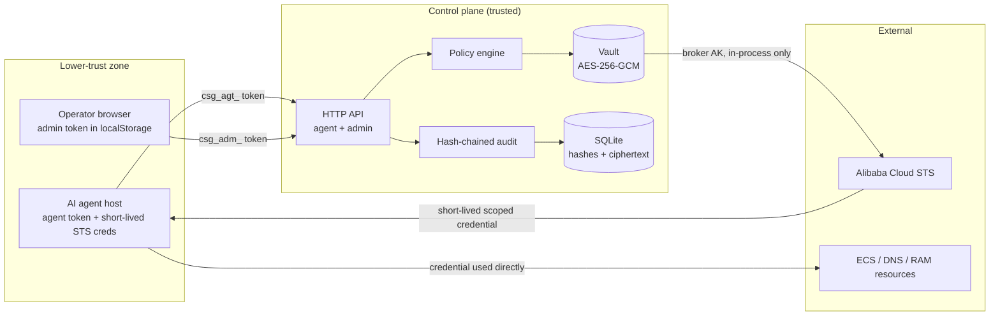

# Cloud Safeguard — Security Model (v0.1)

Status: describes the shipped v0.1 security model. Normative behavior lives in
[CONTRACT.md](CONTRACT.md); product scope in [SPEC.md](SPEC.md). This document is explicit
about **what v0.1 protects, what it only mitigates, and what it does not protect against.**

> Threat-modeling rule for this document: no guarantee is claimed unless the code path or
> acceptance test that enforces it is named. "Documented residual risk" means the exposure
> is real and requires operational mitigation.

---

## 1. Assets

| Asset | Where it lives | Why it matters |
| --- | --- | --- |
| Broker AccessKey/Secret (long-lived) | AES-256-GCM ciphertext in SQLite; master key in `<dataDir>/master.key` (0600) or `CSG_MASTER_KEY` | Full control of the cloud account if leaked |
| Lease credentials (short-lived STS) | Encrypted in SQLite while the lease is active; returned once per fetch from the credential endpoint; held by the agent process | Bounded cloud access for one capability/TTL |
| Master key | Key file outside the database, or injected env var | Decrypts every vault secret |
| Admin token | SHA-256 hash stored in meta; plaintext shown once by `csg init`; held by the human | Root of the control plane |
| Agent tokens | SHA-256 hashes stored; plaintext shown once at create/rotate | Identity and lease-request ability of one agent |
| Audit log | SQLite, hash-chained | Accountability and tamper evidence |
| Policy settings | SQLite | Decides what is auto-approved vs human-approved |
| Control-plane host | The server machine | If fully compromised, the vault can be decrypted in-process |

---

## 2. Trust boundaries



The security model assumes the **control-plane host is trusted** and the **agent host is
not**. The vault never leaves the control-plane process boundary; agents and browsers only
hold bearer tokens and (in `sts` mode) short-lived cloud credentials.

---

## 3. Threat model

| # | Adversary / event | What they get | Impact | v0.1 controls | Residual risk |
| --- | --- | --- | --- | --- | --- |
| T1 | **Agent token leak** (config file, logs, transcript, compromised agent) | A valid `csg_agt_...` token | Can request leases within that agent's grants, fetch credentials | Tokens shown once, hashed at rest; per-agent grants, TTL/concurrency/rate limits; human approval above risk threshold; agent can be suspended/revoked and its token rotated; every use audited | Usable until detected and revoked; an agent allowed to auto-approve low risk can keep minting read credentials |
| T2 | **STS credential leak** (agent logs it, host compromise, shell history) | A short-lived scoped cloud credential | Direct cloud API access as the leased capability | Credential lifetime bounded by TTL (≤ 1800 s built-ins; global max 3600 s); inline policy scoped to capability + params; session name correlates to agent/lease in cloud audit | **Real cloud STS cannot revoke one session instantly.** It stays valid until expiry. Mitigation: short TTL + revoke renewal + role-policy rotation (see §6.4, §7.4) |
| T3 | **Compromised agent host** | Agent token; any credential currently fetched; files on the agent host | Same as T1+T2, plus access to agent-side tooling | The agent host never holds the broker AK; token file should be 0600; lease TTLs bound a stolen credential; `csg exec` revokes on exit by default | Attacker can use the live credential until TTL expiry and can request new leases within grants while the token is valid. Isolate agent hosts; rotate/revoke promptly |
| T4 | **Malicious / over-broad internal agent** (valid token, legitimate grants) | Its grants: e.g. `aliyun.dns.manage` with any valid domain param | Can perform any action the capability allows, on any parameter value the template accepts | Grants are capability-level; risky capabilities require human approval; audit attributes every lease and cloud call; limits bound volume | **No per-parameter grant constraints in v0.1** (P1): an agent granted `aliyun.dns.manage` may pass any valid domain. Review grants, prefer narrow capabilities, and approval thresholds |
| T5 | **Admin token theft** | Control-plane root: create agents/grants, approve break-glass, rotate provider credentials, read all leases/audit | Can grant itself cloud access via the platform | Admin token 32-byte CSPRNG, shown once, SHA-256 at rest, constant-time compare; wrong-kind tokens rejected; all admin actions audited; API never returns broker secret; loopback default; rotate via `csg init --force` | Single token, no MFA/SSO/RBAC; browser stores it in `localStorage` (`csg.adminToken`), so an XSS in the console would exfiltrate it. Never expose the console without TLS |
| T6 | **Database theft** (offline copy of `csg.db`) | Agent/admin token **hashes**, encrypted broker + lease credentials, all metadata/audit | Token hashes are not directly usable; ciphertext needs the master key | AES-256-GCM with AAD binding (`provider/<id>/credential`, `lease/<id>/credential`); broker secret never in plaintext; token hashes one-way; DB file mode 0600 best effort | With DB + master key (same host, same backup) the vault is decryptable. Grants, params, audit and token *prefixes* leak metadata. Encrypt backups; keep master key separate; rotate broker AK if both are exposed |
| T7 | **Master key theft** | Decryption of all vault secrets | Broker AK/SK + any live lease credentials | Key file 0600 outside the DB; optional `CSG_MASTER_KEY` injection (keep it in a secret store, not shell history) | v0.1 has no re-key command: if the master key is exposed, rotate the provider credential after restoring a trusted key, and accept that old ciphertexts remain exposed to the thief |
| T8 | **Audit tampering after the fact** | Ability to rewrite history | Loss of accountability | Append-only table, `hash = SHA-256("csg-audit-v1\n" + prev_hash + "\n" + canonical_event_json)`, `csg audit verify` returns first invalid seq | **Tamper-evident, not tamper-proof.** An attacker with DB write access can rewrite and recompute the whole chain. Export/ship audit events off-box (roadmap) and protect the DB |
| T9 | **Network attacker** | Man-in-the-middle on HTTP | Token/credential theft | Loopback bind by default (`127.0.0.1:8787`); TLS reverse proxy required before exposure; access logs contain no bodies and no `Authorization` values | If the operator binds beyond loopback over plain HTTP, tokens travel in cleartext. No built-in TLS in v0.1 |
| T10 | **Mock cloud abuse** | Mock tokens accepted by the demo cloud only | None outside demo; misleading if mistaken for real isolation | Mock mode is clearly separate; mock tokens are HMAC-signed with a key derived from the master key and are only accepted by `/mock-cloud/`; mock mode must not be exposed | **Mock mode is not a security boundary.** It is a demo/test facility. Never deploy with a mock provider serving untrusted callers |
| T11 | **Broker AK used outside the platform** | Full account access | Defeats the product guarantees | Rotation runbook (§6), one-place credential storage, audit of rotation | If old copies of the broker AK still exist (the exact problem this product solves), **the guarantees do not hold**. Retire all copies when adopting the platform |
| T12 | **Denial of service / resource exhaustion** | Slows or stops the control plane | Loss of availability | Per-agent rate limit (`leases_per_minute_per_agent`, default 6) and concurrency limit (default 3); 1 MiB request body cap; 10 s HTTP timeouts | No global rate limit/WAF; single process; local artifact |
| T13 | **Insider with control-plane access** | Can read DB/logs, run the binary, inject `CSG_MASTER_KEY` | Full compromise | Same-host trust assumption; keep the host dedicated and access-controlled | Out of scope for v0.1; needs OS controls, SSO and possibly HSM/KMS |

---

## 4. Security guarantees (what v0.1 enforces)

Each guarantee names where it is enforced:

1. **No long-lived cloud credential outside the vault.**
   - Broker AccessKey/Secret are encrypted with AES-256-GCM and never returned by any API
     (only `access_key_id_masked`, e.g. `LTAI****9f2c`), never logged, never included in
     error messages or audit metadata.
   - The plaintext exists only inside the minting call in the control-plane process.
2. **Agents hold platform tokens, not cloud keys.**
   - Agent tokens are 32-byte CSPRNG values with prefix `csg_agt_`; only the SHA-256 hash is
     stored; the plaintext is shown exactly once at creation/rotation.
   - Admin endpoints require `csg_adm_` tokens; agent endpoints require `csg_agt_` tokens;
     wrong-kind tokens are rejected `401`. Suspended/revoked agents get `403`.
3. **Every minted credential is least-privilege and TTL-bounded.**
   - The IAM policy is rendered from the capability template and validated request params
     (e.g. `acs:alidns:*:*:domain/<domain>`), then passed as the STS session inline policy.
   - TTL is bounded three ways (capability max, agent max, global max) **server-side**; the
     sweeper expires leases and scrubs credentials.
   - The cloud `RoleSessionName` is `csg-<agentID>-<leaseID>` (sanitized, ≤64 chars), so
     Alibaba Cloud audit trails can be correlated to a platform lease.
4. **Enforcement cannot be bypassed by the agent.**
   - Lease state transitions, approval, TTL overrides, concurrency/rate limits and
     revocation are decided server-side; the agent cannot approve its own lease, extend its
     TTL, read another agent's lease (`404`), or reuse a credential after revoke/expiry in
     mock mode.
   - In mock mode, **every mock cloud call re-validates** the token signature, expiry,
     provider mode, lease `active` status (live store lookup) and the IAM policy — so
     revocation is immediate in the demo.
5. **One-place rotation.**
   - `csg providers rotate` / console rotate re-encrypts the new AK/SK with the vault and
     audits `provider.credential_rotated` (masked IDs only). Existing leases keep working;
     subsequent leases mint with the new credential; no agent or server-side copy changes.
6. **Accountability.**
   - Every request, decision, issuance, fetch, revoke, provider change, agent change,
     policy change and mock cloud API call appends a hash-chained audit event with actor,
     action, status, severity and non-secret metadata. `csg audit verify` / the console
     verifies the chain and reports the first invalid seq.
7. **Secret hygiene by construction.**
   - Access logs are `method path status duration_ms` — no bodies, no `Authorization`.
   - Error `details` never contain secrets. DB scans for plaintext fixture secrets/tokens
     are part of the test suite (acceptance A8). `csg providers add/rotate` accepts secrets
     via file or stdin, not required command-line args.

---

## 5. Why not just give the agent `AdministratorAccess`?

| Dimension | Full-admin long-lived AK | Cloud Safeguard lease |
| --- | --- | --- |
| Credential lifetime | Until manually rotated | Minutes (bounded by TTL; max 1 h by default) |
| Blast radius | Entire account: ECS, DNS, RAM, billing, data | One capability + one resource param |
| Leak response | Rotate key everywhere; rebuild trust in every copy | Revoke lease/agent; renewal denied; TTL expires; cloud session name points at the lease |
| Attribution | "A RAM user did it" | Agent + lease + decision + approver + timestamp |
| Rotation | Hunt every copy across servers/agents/CI | One console/CLI action |
| Convenience | High | High for low risk (auto-approve); one click for risky |
| Audit tamper evidence | Cloud-side only | Local hash chain + cloud session correlation |

Handing out full admin is not a permissions strategy; it is a bet that the key never leaks.
The bet is bad because the key propagates to every machine, script and tool that touches
the account — exactly the failure mode this product removes.

---

## 6. Credential rotation runbook

### 6.1 The old world (why this matters)

The founding setup had the broker AccessKey copied into at least:

- `~/.aliyun/config.json` — the Alibaba Cloud CLI profile (`profiles[].access_key_id` /
  `access_key_secret`);
- `~/.acme.sh/account.conf` — ACME DNS-01 renewals via the AliDNS hook
  (`SAVED_ALI_KEY` / `SAVED_ALI_SECRET` and similar saved values);
- agent tool/plugin configuration;
- possibly CI secrets, Terraform variables, shell history.

A rotation that misses one copy produces no immediate error. The breakage surfaces at the
next unattended certificate renewal, or the next agent run months later. That is the
"convenience vs security" tax paid in silent failures.

### 6.2 One-place rotation (normal operation)

Only one copy of the broker credential exists — the encrypted vault row. Rotation is:

1. **Create a new AccessKey** for the same broker RAM user in Alibaba Cloud (keep the old
   one enabled until verified).
2. **Rotate it into the platform** — console *Providers & Vault → Rotate credential*, or:

   ```bash
   # Never pass the secret as a command-line argument (shell history, process list).
   install -m 600 /dev/null /tmp/csg-broker-new.secret
   # write the new secret into that file with your secret tooling, then:
   ./bin/csg providers rotate prv_xxxxxxxx \
     --access-key-id 'LTAI...new-id' \
     --access-key-secret-file /tmp/csg-broker-new.secret
   shred -u /tmp/csg-broker-new.secret 2>/dev/null || rm -f /tmp/csg-broker-new.secret
   ```

   (`--access-key-secret-stdin` is also supported.) The platform audits
   `provider.credential_rotated` with masked AccessKey IDs only.
3. **Test**: `./bin/csg providers test prv_xxxxxxxx` → passes (real `sts` mode performs a
   signed `GetCallerIdentity`).
4. **Smoke test a lease**: request `aliyun.cloud.read`, fetch the credential, make one
   read call. This proves the new credential mints correctly.
5. **Retire the old AccessKey** in Alibaba Cloud RAM (disable, then delete after a grace
   period). Do not delete before step 4 passes.

Existing lease credentials are unaffected until their own expiry; the next lease mints
with the new broker credential. No agent, server script, cron entry or host file changes.

### 6.3 Rotation after a suspected leak

1. Revoke all leases of the affected agents/leases, or rotate the affected agent token
   (see §7).
2. Rotate the broker credential (§6.2) and then delete the old AccessKey immediately.
3. If the leak may have included an issued STS credential: revoke its lease and tighten
   the RAM role policy with an explicit `Deny` for the affected actions/resources — an
   already-issued STS session cannot be revoked one-by-one and remains valid until its
   expiry (bounded by the TTL you granted).
4. Verify the audit chain and preserve a DB copy (§7).
5. If the control-plane host or DB+master key may be compromised, treat the broker key as
   burned: rotate it and assume the vault contents were readable.

### 6.4 Retiring the old copies (adoption step)

The platform cannot find copies that already exist. When adopting it, remove the
long-lived key from everything except the vault:

- `~/.aliyun/config.json` → replace with a profile that uses an STS credential fetched via
  `csg credential --export`, or with `ALIBABA_CLOUD_*` env vars injected by `csg exec`.
  Note that the Alibaba Cloud CLI resolves the config file **before** environment
  variables, so delete the stale profile (or set `ALIBABA_CLOUD_IGNORE_PROFILE=TRUE`) — an
  old profile would silently override the lease credential;
- `~/.acme.sh/account.conf` → use a short-lived STS lease for DNS-01 (the
  `aliyun.cert.dns01` capability was designed for exactly this) or a dedicated, narrowly
  scoped account, and rotate/remove `SAVED_ALI_*` entries;
- agent configs, CI secrets, Terraform vars → replace with `csg exec` / `csg credential`
  (or, later, proxy mode).

Until this is done, the guarantees in §4 do not hold for those copies — they are outside
the vault and outside the audit chain.

### 6.5 Real `sts` mode: the RAM role policy is the outer bound

In real Alibaba Cloud STS mode, the permissions of the minted credential are the
**intersection** of the RAM role's attached policies and the per-lease inline policy that
Cloud Safeguard renders at `AssumeRole` time. The inline policy can only narrow; it cannot
grant an action the role does not already have. Practical consequences:

- Attach to the `csg-agent` role the **union** of the actions your capability catalog is
  allowed to grant, and no more. That role policy is the ceiling for every lease and for
  any misuse of the broker AccessKey (which can call `AssumeRole` with an arbitrary
  `Policy` parameter, but never exceed the role).
- `aliyun.iam.break_glass` carries `Action: "*"`, but in real mode it is still bounded by
  the role policy unless you widen the role. Start narrow; widen only with a documented,
  audited intent.
- If a capability request succeeds in the platform but the real API returns a RAM
  `Forbidden` error, the missing permission is almost always in the role's attached
  policy (the inline policy already allows it).
- Rotating a leaked **broker** key does not by itself revoke already-issued STS sessions;
  tighten the role policy with an explicit `Deny` (or detach the role), rotate the key,
  and let the short TTLs expire the sessions.

---

## 7. Deployment hardening checklist

**Network**

- [ ] Keep the default `127.0.0.1:8787` loopback bind. The console and API are never
      exposed directly to the internet.
- [ ] If remote access is required, front it with a TLS reverse proxy (nginx, Caddy,
      Envoy) and do not publish the plain-HTTP port. Example nginx location:

      ```nginx
      server {
        listen 443 ssl;
        server_name csg.internal.example.com;
        # ssl_certificate / ssl_certificate_key ...
        location / {
          proxy_pass http://127.0.0.1:8787;
          proxy_set_header Host $host;
          proxy_set_header X-Forwarded-For $proxy_add_x_forwarded_for;
        }
      }
      ```

- [ ] Firewall the host; nothing else listens on the control-plane interface.
- [ ] Keep system time in sync (UTC is used everywhere; audit timestamps depend on it).

**Host & files**

- [ ] Run `csg` as a dedicated unprivileged user, not root; separate host from agent hosts.
- [ ] Data dir mode `0700`, `master.key` `0600`, DB `0600` (v0.1 creates them that way best
      effort; verify with `ls -l`).
- [ ] Set `umask 077` for the service account so future files (logs, backups) are private.
- [ ] Disable core dumps for the service (they can contain decrypted secrets in memory).

**Master key**

- [ ] Prefer injecting `CSG_MASTER_KEY` from a secret manager / systemd `EnvironmentFile`
      (0600) over leaving the key file on the same disk as the DB.
- [ ] Back up the master key **separately** from the database. Lose it and every vault
      secret is unrecoverable; leak it (with the DB) and the vault is open.
- [ ] Never paste the master key into shell history, tickets or chat.

**Mock mode**

- [ ] Production installs: `csg init` **without** `--demo`, so no mock provider and no
      `/mock-cloud/` endpoint exists.
- [ ] If a mock provider exists from testing, disable/remove it and restart; never expose
      the console/API where mock mode is enabled. **Mock mode is not a security boundary.**

**Tokens**

- [ ] Keep the admin token in a password manager; enter it only on the console login page
      (stored in `localStorage` for the session) or via `csg login`.
- [ ] Rotate the admin token on suspicion or personnel change:
      `csg init --force --data-dir <dir>` (rotates the admin token, keeps data, re-prints
      the new token once).
- [ ] One agent token per agent; store on the agent host as 0600; rotate with
      `csg agents rotate-token` (old token invalid immediately); suspend/revoke rather
      than silently sharing tokens.
- [ ] Register agents with the minimum grants, and set `max_ttl`/`max_concurrent` per
      agent. Prefer `csg exec` (auto-revokes on exit) over long-lived exported env vars.

**Policy & operations**

- [ ] Review the guardrails in *Settings*: `auto_approve_max_risk`, auto TTL ceiling, max
      TTL, pending timeout, concurrency, rate, reason-required threshold. Raise
      `auto_approve_max_risk` only deliberately (each change is audited).
- [ ] Keep `critical` capabilities (`aliyun.iam.break_glass`) human-approved only; perform
      a break-glass drill, including revocation.
- [ ] Watch audit `severity=critical|warning` and denied leases in the console.
- [ ] Verify the chain regularly: `csg audit verify` (e.g. daily) and after any suspicious
      event. The checksum detects partial/accidental tampering; it is not a substitute for
      off-box log shipping.
- [ ] Retain the DB (audit log) per your policy; v0.1 has **no automatic retention or
      export** — back up the DB and do not delete audit rows (it breaks the hash chain).
- [ ] Treat provider rotation events and admin logins as security-relevant alerts.

---

## 8. Incident response runbook

Order matters: **contain first, then rotate, then verify.**

### 8.1 Contain

1. **Suspend or revoke the agent** (blocks all agent endpoints immediately):

   ```bash
   ./bin/csg agents suspend agt_xxxxxxxx
   ./bin/csg agents rotate-token agt_xxxxxxxx   # invalidates the old token immediately
   ```

2. **Revoke its leases** (scrubs stored credentials; stops renewal):

   ```bash
   ./bin/csg leases list --agent agt_xxxxxxxx --status active
   ./bin/csg leases revoke lea_xxxxxxxx --reason "incident: agent compromise"
   ```

3. If the agent itself was malicious, also rotate its token and review its grants and
   recent leases in the console.

### 8.2 Eradicate / rotate

4. **Suspect STS credential leak (real `sts` mode)**: revoke the lease, then edit the RAM
   role policy (or role trust policy) to deny the affected actions (e.g. an explicit
   `Deny` statement for `ecs:RebootInstance`, or detach the role from use). The already
   issued session can remain valid until its expiry — that is why TTLs are short. Do not
   assume revocation in the control plane kills the cloud-side session instantly.
5. **Suspect broker credential leak**: rotate the provider credential (§6.2), delete the
   old AccessKey in RAM, and rotate the affected agent tokens.
6. **Suspect control-plane compromise / DB+master key exposure**: rotate the broker
   credential, rotate the admin token (`csg init --force`), move the installation to a
   trusted host if needed.

### 8.3 Verify and preserve evidence

7. Verify the audit chain: `./bin/csg audit verify` → `ok=true, events=N`. If it reports
   `first_invalid_seq`, treat the audit log as compromised.
8. Export the relevant events (`./bin/csg audit list --action lease.revoked --json`, etc.)
   and preserve an untouched copy of the DB + master key for forensics. Do not delete
   audit rows.
9. Correlate cloud-side activity with the platform: `RoleSessionName` follows
   `csg-<agentID>-<leaseID>`; filter Alibaba Cloud ActionTrail by that session name to
   find every action the credential performed. Cross-check against platform
   `cloud.api_called` events.
10. Check for unreviewed `policy.updated`, `provider.*` and `auth.*` events in the audit log.

### 8.4 Recover and learn

11. Re-test the provider (`csg providers test`), create new agent tokens, re-grant the
    minimum capability set, and re-enable the agent.
12. Tighten guardrails (raise approval thresholds, lower TTLs, run a break-glass drill),
    and update this runbook with what actually happened.

---

## 9. What v0.1 explicitly does NOT protect against

Be precise about non-guarantees:

1. **Instant cloud-side revocation of an individual real STS session.** Alibaba Cloud STS
   sessions cannot be individually revoked; the platform stops renewal and scrubs its copy,
   and TTL bounds the window. Incident response must also touch the RAM role policy.
2. **Mock mode as an isolation boundary.** Mock tokens are locally signed and accepted
   only by the built-in mock cloud; mock mode is for demos/tests. Running it with
   untrusted clients is not a security control.
3. **Master-key compromise.** The vault protects data at rest relative to the DB; it cannot
   protect secrets from someone who can read the key file or inject `CSG_MASTER_KEY` into
   the process.
4. **Full audit-history rewrite by a DB-privileged attacker.** The hash chain is
   tamper-evident against partial/accidental modification; it is not a signature or an
   anchor to an external system. There is no off-box shipping in v0.1.
5. **Admin-token theft and browser XSS.** There is a single admin token, no MFA/SSO/RBAC,
   and the console keeps it in `localStorage`. An XSS in the console equals admin
   compromise. No external CDN/fonts are used and the app is same-origin, but this reduces
   rather than eliminates the risk.
6. **A malicious agent operating within its legitimate grants.** v0.1 has no per-parameter
   grant constraints; `aliyun.dns.manage` means *any valid domain*, not a pinned one. Use
   risk thresholds, short TTLs, narrow capabilities and human approval for the rest.
7. **Compromised agent host / stolen live STS credential.** The host can read the
   credential it is using (by design in v0.1 — proxy mode is P1) and keep using it until
   TTL expiry.
8. **Cloud-side compromise, provider misconfiguration, or broker keys that still exist
   outside the vault.** If old copies of the long-lived key were not retired (§6.4), the
   product's guarantees do not cover them.
9. **Multi-tenant isolation, SSO, RBAC, HA, external KMS/HSM, DDoS/WAF.** All roadmap
   (P1/P2); single-tenant local artifact in v0.1.
10. **No independent security audit has been performed on v0.1.** Treat the security model
    as reviewed-by-construction, not audited.

---

## 10. Reporting a security issue

This is a v0.1 local artifact. If you find a vulnerability, reproduce it in an isolated
demo instance, describe the impact and affected contract section, and report it to the
maintainer rather than opening a public issue with exploit details. Do not include real
credentials, tokens or master keys in any report; use the demo/mock environment.
